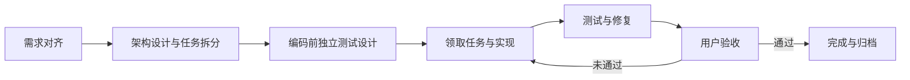

# AI Development Workflow

一套可复用的 AI 协作开发工作流，将架构设计、任务拆分、独立测试设计、任务执行和用户验收组织成可持续跟踪的开发过程。

通过三个技能和一套项目文档，让 AI 在跨会话开发中明确当前目标、任务归属、验证依据和推进状态。适用于不同技术栈的个人与团队项目，可通过显式读取技能文件在 Codex、Claude Code、Zcode 中使用。

## 工作流程



| 技能 | 职责 | 主要产出 |
| --- | --- | --- |
| **architect** | 审计假设、确定架构边界、拆分任务、明确依赖与并行关系 | 架构文档、任务卡、验收目标 |
| **verification-owner** | 在编码前独立定义正确结果、测试场景与证据要求 | 验证规格、用户验收步骤 |
| **coding-owner** | 领取任务、实现、执行测试、修复问题、交付用户验收 | 实现结果、执行证据、验收清单 |

测试设计先于实现，执行与修复由同一 Coding Owner 持续负责。自动化通过后交给用户验收，用户明确整体通过后才完成任务。

## 项目内容

```text
skills/                三个技能及参考资料
project-template/      项目入口、任务库和进度文档骨架
templates/             任务卡、验证规格、证据、验收与决策模板
docs/                  接入、角色提示词和状态跟踪指南
examples/              完整的虚构工作包示例
tests/                 任务工具与接入检查
```

## 接入项目

下载或克隆本项目到本地，选择以下一种方式接入自己的代码项目。

### 方式一：手动复制

按下表将文件复制到目标项目。保留技能目录中的 `references/`；已有同名文件应合并，保留原项目内容。

| 本项目中的位置 | 目标项目中的位置 |
| --- | --- |
| `project-template/.tasks/` | `.tasks/` |
| `skills/` | `.workflow/skills/` |
| `templates/` | `.workflow/templates/` |
| `docs/` | `.workflow/docs/` |
| `project-template/AGENTS.md` | `AGENTS.md` |
| `project-template/CLAUDE.md` | `CLAUDE.md`（按需使用） |
| `project-template/docs/TASK.md` | `docs/TASK.md` |
| `project-template/docs/PROGRESS.md` | `docs/PROGRESS.md` |

在项目入口中补充项目边界、模块说明路径、启动与测试命令。任务区初始保持为空；首次需求规划时再创建架构与任务卡。

### 方式二：让 AI 搭建

在目标项目中打开 Codex、Claude Code 或 Zcode，替换下面的来源路径后发送：

```text
请将 AI Development Workflow 接入当前项目。
工作流来源目录：填写本地 ai-development-workflow 的完整路径。
目标目录：当前项目根目录。

先阅读来源 README.md、docs/adoption.md 和 project-template/.tasks/WORKFLOW.md，
再检查当前项目已有的入口、模块规则与任务记录。

按照 README 的复制表完成搭建：
- 接入 .tasks、.workflow/skills、.workflow/templates、.workflow/docs。
- 合并 AGENTS.md、按需合并 CLAUDE.md，接入 docs/TASK.md 和 PROGRESS.md。
- 保留原项目规则、已有任务和未提交修改；遇到冲突明确指出，不直接覆盖。
- 在项目入口写明三个 SKILL.md 的实际路径和按需读取规则。
- 根据实际仓库补充项目边界、模块路由、启动与测试命令；未知项标为待确认。

只搭建工作流，不创建业务任务、不修改业务代码，不安装额外运行环境。
不要引入示例任务、旧方案或来源项目历史。
检查目录、引用与规则一致性，列出新增和合并文件、检查结果及待确认项。
不提交或推送 Git。
```

搭建完成后，通过 `.workflow/skills/<技能名>/SKILL.md` 显式调用角色。已配置技能快捷调用的环境也可使用 `$architect`、`$verification-owner`、`$coding-owner`。

## 开始开发

### 1. 架构设计与任务拆分

向 AI 说明目标与约束：

```text
读取 .workflow/skills/architect/SKILL.md，规划以下需求：
需求：……
目标与约束：……
请输出架构边界、最少任务卡、依赖关系和验收目标，先不要实现。
```

评审并批准架构和任务后，进入测试设计。

### 2. 独立测试设计

在独立会话或上下文中指定任务：

```text
读取 .workflow/skills/verification-owner/SKILL.md，
为已批准的 TASK-001 设计编码前独立验证规格。
依据架构、任务验收目标和公开契约定义正确结果、风险场景与证据要求。
完成规格和就绪状态更新后停止，不实现代码。
```

验证规格就绪且所有硬依赖已完成后，任务才可领取。

### 3. 领取与执行

```text
读取 .workflow/skills/coding-owner/SKILL.md，执行 TASK-001。
确认领取条件后记录 Owner，完成实现、测试、验证、自修复和证据记录。
自动化通过后提供详细用户验收清单，停在 awaiting_acceptance，等待我验收。
```

验收未通过时，由原 Owner 修复并重新验证。用户明确整体通过后，记录验收证据、完成任务并归档；不自动领取下一张任务。

## 状态与记录

```text
pending → ready → in_progress → awaiting_acceptance → done
```

| 文件位置 | 保存内容 |
| --- | --- |
| `.tasks/architecture.md` | 工作包目标、架构边界与约束 |
| `.tasks/cards/active/` | 任务范围、依赖、状态与 Owner |
| `.tasks/verification/` | 编码前独立验证规格 |
| `.tasks/evidence/` | 执行结果、修复记录与用户验收证据 |
| `.tasks/index.yaml` | 由任务卡生成的活动摘要 |
| `.tasks/archive/` | 已完成任务的完整历史包 |
| `docs/PROGRESS.md` | 工作包完成后的阶段历史 |

恢复开发时，指定 Task ID，读取对应角色所需文件即可继续推进。阻塞、架构升级、证据维护与归档规则见 [工作流规范](project-template/.tasks/WORKFLOW.md)。

## 文档与示例

- [接入指南](docs/adoption.md)
- [完整角色提示词](docs/prompts.md)
- [状态与推进记录](docs/state-and-tracking.md)
- [数据契约与任务工具](docs/data-contracts.md)
- [任务工具使用](docs/task-tools.md)
- [工作包示例](examples/report-export/README.md)
- [贡献指南](CONTRIBUTING.md)

## 许可证

[MIT](LICENSE)
